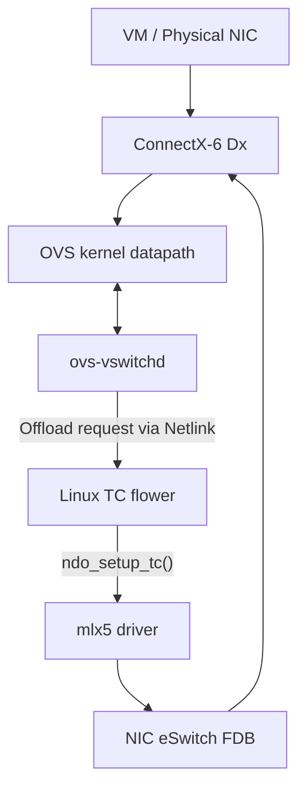
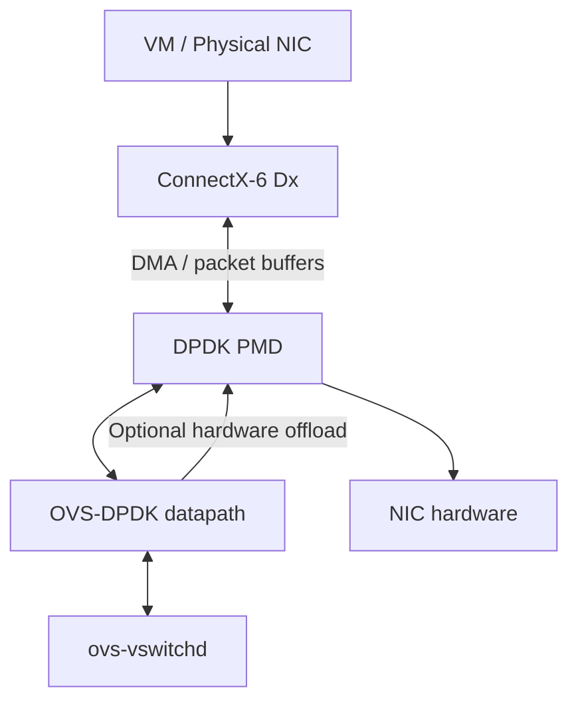
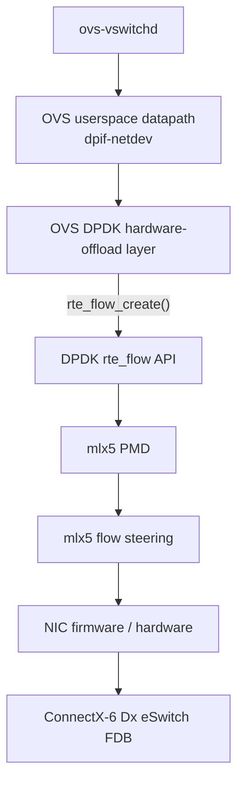
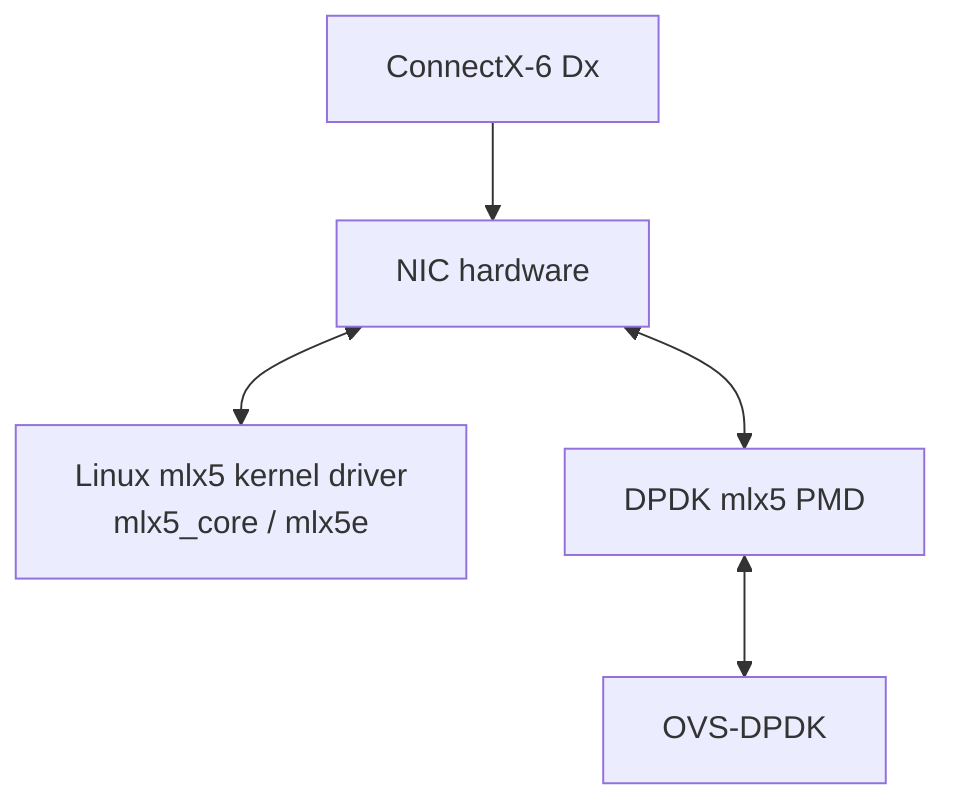

# OVS-DPDK vs OVS kernel datapath: How does hardware offloading differ?

The most important distinction is that OVS-DPDK bypasses the Linux kernel networking datapath, whereas
traditional OVS uses the kernel datapath and TC flower to communicate with the NIC driver.

However, there is an important nuance: OVS-DPDK does not necessarily bypass the Linux kernel for hardware
configuration. It can still use kernel interfaces and drivers to configure the NIC, depending on the PMD and
hardware-offload architecture.

Let's connect this to what we've already studied with your ConnectX-6 Dx.

## 1. Two different OVS architectures

### A. OVS with the Linux kernel datapath

This is the architecture we've been investigating.

OVS userspace (`ovs-vswitchd`) communicates with the kernel OVS datapath. The kernel datapath handles
packets and can request hardware offload through TC flower.



The important call chain is:

```text
    ovs-vswitchd
        |
        v
    OVS kernel datapath
        |
        v
    TC Netlink
        |
        v
    mlx5e_setup_tc()
        |
        v
    mlx5e_setup_tc_block_cb()
        |
        v
    mlx5e_setup_tc_cls_flower()
        |
        v
    mlx5e_configure_flower()
        |
        v
    mlx5e_add_fdb_flow()
        |
        v
    mlx5_add_flow_rules()
        |
        v
    NIC eSwitch FDB
```

This is the TC flower path ( `./OVS-mlx.md` )

### B. OVS with DPDK

With OVS-DPDK, OVS uses a userspace datapath built on top of DPDK.

Instead of relying on the Linux kernel OVS datapath for packet forwarding, OVS processes packets in
userspace using DPDK poll-mode drivers (PMDs).



The key differences:

- OVS processes packets in userspace.
- DPDK PMDs poll RX queues instead of relying on normal kernel packet reception.
- Packet buffers are commonly represented by DPDK `rte_mbuf` objects.
- CPU cores are dedicated to polling and processing packets.
- Hardware offload can be requested through DPDK interfaces rather than the traditional TC flower path.

## 2. The biggest difference: where packets are processed

This is the fundamental architectural difference.

OVS kernel datapath

Kernel forwarding1. NIC receives packet.
2. Linux kernel networking receives packet.
3. OVS kernel datapath performs flow lookup and forwarding.
4. Packet may be sent to userspace for control-plane processing or upcalls.

OVS-DPDK

Userspace forwarding1. NIC receives packet.
2. DPDK PMD polls the RX queue.
3. OVS userspace datapath performs flow lookup.
4. OVS sends packet through a DPDK TX queue.

| Feature | OVS kernel | OVS-DPDK |
| --- | --- | --- |
| Datapath | Kernel | Userspace |
| Packet processing | Kernel | Userspace |
| Packet I/O | Linux networking | DPDK PMD |
| Packet buffer | `sk_buff` | `rte_mbuf` |
| RX mechanism | Interrupt/NAPI-based networking | Poll mode |
| Flow management | Kernel OVS datapath | OVS userspace datapath |
| Hardware flow API | TC flower | DPDK `rte_flow` |
| Driver integration | `ndo_setup_tc()` | DPDK PMD |

One important point: `ovs-vswitchd` is userspace in both architectures. The difference is the datapath that
actually forwards packets.

## 3. How does OVS-DPDK communicate with Mellanox hardware?

Now we get to the interesting part.

With the kernel datapath, our path was:

```text
    OVS
     |
     v
    TC flower
     |
     v
    ndo_setup_tc()
     |
     v
    mlx5e_setup_tc()
     |
     v
    mlx5 driver
     |
     v
    mlx5_add_flow_rules()
     |
     v
    NIC hardware
```

With OVS-DPDK hardware offload, the architecture changes.

Instead of using TC flower as the primary flow-programming interface, OVS uses DPDK's `rte_flow` API.

The Mellanox DPDK driver is called:

mlx5 PMD (Poll Mode Driver).

Its implementation is part of DPDK, not the Linux kernel's `drivers/net/ethernet/mellanox/mlx5/core/en_tc.c`.

### The new architecture



The key difference:

- Kernel OVS: TC flower describes the rule.
- OVS-DPDK: `rte_flow` describes the rule.
- mlx5 PMD translates the DPDK flow description into mlx5 hardware steering operations.

The DPDK documentation describes `rte_flow` as its generic flow rule interface, with hardware capabilities depending on the PMD.

## 4. What is `rte_flow`?

This is the DPDK equivalent of the TC flower concept at the flow-rule API level.

In Linux TC, you might describe a rule as:

```bash
tc filter add dev eth0 ingress \
    protocol ip flower \
    dst_ip 192.168.2.20 \
    ip_proto tcp \
    dst_port 443 \
    action drop
```

In DPDK, you describe the same kind of rule using:

```c
struct rte_flow_attr attr;

struct rte_flow_item pattern[] = {
    /* Ethernet match */
    /* IPv4 match */
    /* TCP match */
    { .type = RTE_FLOW_ITEM_TYPE_END }
};

struct rte_flow_action actions[] = {
    /* Drop action */
    { .type = RTE_FLOW_ACTION_TYPE_DROP },
    { .type = RTE_FLOW_ACTION_TYPE_END }
};

struct rte_flow_error error;

struct rte_flow *flow =
    rte_flow_create(
        port_id,
        &attr,
        pattern,
        actions,
        &error);
```

This is illustrative code, not a complete executable rule: the actual item specifications, masks, attributes and error handling must also be populated.

The concepts are almost identical:

| TC flower | DPDK rte\_flow |
| --- | --- |
| Match keys | `rte_flow_item` |
| Match masks | Item masks |
| Actions | `rte_flow_action` |
| Flow installation | `rte_flow_create()` |
| Flow deletion | `rte_flow_destroy()` |
| Flow validation | `rte_flow_validate()` |
| Flow attributes | `rte_flow_attr` |

For example:

```text
Match:
    IPv4 destination = 192.168.2.20
    TCP destination port = 443

Action:
    Drop
```

The DPDK API passes this description to the selected PMD.

The mlx5 PMD then determines how to implement it on the NIC.

See the [DPDK mlx5 PMD documentation](<https://github.com/DPDK/dpdk/blob/main/doc/guides/nics/mlx5.rst?utm_source=chatgpt.com>).

## 5. What happens inside the Mellanox DPDK driver?

Here is where we need to distinguish two different implementations:

| Linux kernel mlx5 | DPDK mlx5 |
| --- | --- |
| `en_tc.c` | `drivers/net/mlx5/` in DPDK |
| `mlx5e_setup_tc()` | DPDK ethdev operations |
| TC flower | `rte_flow` |
| `mlx5e_add_fdb_flow()` | mlx5 PMD flow implementation |
| `mlx5_add_flow_rules()` | mlx5 PMD steering implementation |

The DPDK mlx5 PMD contains its own flow management implementation.

Its responsibilities include:

1. Receive the `rte_flow` request.
2. Parse the match pattern.
3. Translate the requested actions.
4. Check hardware capabilities.
5. Create the hardware steering resources.
6. Install the flow into the appropriate hardware flow table.

The exact internal call chain depends on the DPDK version and whether the PMD uses legacy steering or hardware steering (HWS).

Important: Do not assume that `rte_flow_create()` directly invokes one particular mlx5 function. It enters the DPDK ethdev/PMD abstraction, and the mlx5 PMD dispatches it through its configured flow implementation.

## 6. Very important: mlx5 uses a bifurcated driver architecture

This is one of the most interesting differences between Mellanox and some other DPDK NIC drivers.

For many DPDK devices, the traditional approach is:

text

```text
NIC
 |
 v
Unbind from Linux driver
 |
 v
Bind to vfio-pci
 |
 v
DPDK owns the device
```

However, mlx5 generally uses a bifurcated driver.

Conceptually:

mermaid



The kernel driver and DPDK PMD coexist.

The mlx5 PMD uses kernel mlx5 infrastructure and RDMA libraries such as `rdma-core` for device access and resource management.

This means:

- You generally do not unbind the ConnectX-6 Dx PF from `mlx5_core`.
- The Linux kernel driver continues to exist.
- DPDK gets its own userspace packet-processing and steering interfaces.
- Hardware resources are managed through the mlx5 driver/firmware architecture.

This is particularly important when studying ConnectX-6 Dx.

The [DPDK mlx5 documentation](<https://github.com/DPDK/dpdk/blob/main/doc/guides/nics/mlx5.rst?utm_source=chatgpt.com>) explicitly describes this bifurcated model and its Linux kernel driver dependencies.


## 7. What about switchdev and representors in OVS-DPDK?

This is where the two architectures become especially interesting.

Remember our earlier discussion:

- eSwitch: Hardware switching engine.
- Representor: Linux interface representing an eSwitch port.
- FDB: Hardware forwarding database.

These concepts still exist with OVS-DPDK.

However, the representor can also be exposed as a DPDK Ethernet device through the mlx5 PMD.

For example, conceptually:

```text
              ConnectX-6 Dx
        +-------------------------+
        |                         |
        |       Embedded          |
        |        Switch           |
        |                         |
        |    +-----------+        |
        |    |   Uplink  |        |
        |    +-----------+        |
        |                         |
        |    +-----------+        |
        |    |   VF0     |        |
        |    +-----------+        |
        |                         |
        |    +-----------+        |
        |    |   VF1     |        |
        |    +-----------+        |
        |                         |
        +-------------------------+
             |      |      |
             v      v      v
           Uplink  VF0    VF1
          representors
             |
             v
          DPDK mlx5 PMD
             |
             v
          OVS-DPDK
```

OVS-DPDK can use representor ports to control the eSwitch.

For example, OVS might have:

```text
br0
 |
 +-- uplink representor
 |
 +-- VF0 representor
 |
 +-- VF1 representor
```

The DPDK application can use these ports and request hardware flow rules through `rte_flow`.

The rule can describe:

```text
Ingress port: VF0

Match:
    Destination MAC = VM1 MAC

Action:
    Forward to VF1
```

The mlx5 PMD translates the rule into hardware steering operations in the eSwitch.

The resulting packet forwarding can happen entirely inside the NIC.

NVIDIA documents OVS-DPDK hardware offload using its ASAP² architecture, including switchdev configuration and representors.

MLNX\_OFED Software

## 8. Compare the two complete hardware-offload paths

This is the most important comparison for our investigation.

Architecture A — OVS kernel datapath + mlx5 kernel driver

TC flowertext

```text
ovs-vswitchd
     |
     v
OVS kernel datapath
     |
     v
TC flower / Netlink
     |
     v
ndo_setup_tc()
     |
     v
mlx5e_setup_tc()
     |
     v
mlx5e_setup_tc_block_cb()
     |
     v
mlx5e_setup_tc_cls_flower()
     |
     v
mlx5e_configure_flower()
     |
     v
mlx5e_add_fdb_flow()
     |
     v
mlx5 flow steering
     |
     v
ConnectX-6 Dx eSwitch FDB
```

Architecture B — OVS-DPDK + mlx5 PMD

DPDK rte\_flowtext

```text
ovs-vswitchd
     |
     v
OVS userspace datapath
     |
     v
OVS DPDK offload layer
     |
     v
DPDK rte_flow API
     |
     v
mlx5 PMD
     |
     v
mlx5 flow steering
     |
     v
ConnectX-6 Dx eSwitch FDB
```

Notice something important:

Both architectures can ultimately program the same NIC hardware, but they reach it through different software interfaces.

That is the key insight.

The hardware does not care whether the original request came from TC flower or DPDK `rte_flow`. It receives hardware steering configuration through the relevant driver infrastructure.

## 9. Does OVS-DPDK always use hardware offloading?

No.

This is another distinction worth remembering.

OVS-DPDK can operate in two modes:

### Mode 1: Software forwarding

```text
NIC
 |
 v
DPDK RX queue
 |
 v
mlx5 PMD
 |
 v
OVS-DPDK flow lookup
 |
 v
OVS forwarding decision
 |
 v
DPDK TX queue
 |
 v
NIC
```

Here, the CPU processes packets using OVS userspace.

### Mode 2: Hardware forwarding

```text
NIC
 |
 v
eSwitch FDB
 |
 v
Hardware match/action
 |
 v
Destination port
```

Here, matching packets can bypass the OVS software forwarding path entirely.

OVS still maintains the control-plane state, but the NIC handles matching packets.

Hardware offload is optional and requires compatible hardware, PMD support, supported match/action combinations and appropriate configuration. OVS documents the `hw-offload` setting and the limitations of supported flow actions.


## 10. Which source files should we investigate?

Now we have two different codebases to study.

| Component | Kernel OVS | OVS-DPDK |
| --- | --- | --- |
| OVS datapath | `datapath/` | `lib/dpif-netdev.c` |
| NIC integration | Kernel TC | `lib/netdev-offload-dpdk.c` |
| NIC port implementation | mlx5 kernel driver | `lib/netdev-dpdk.c` |
| Flow API | TC flower | `rte_flow` |
| Hardware driver | `mlx5_core` | DPDK mlx5 PMD |
| Hardware steering | `fs_core.c` | DPDK mlx5 flow implementation |

For DPDK, I suggest investigating these locations:

Open vSwitch source:

```text
openvswitch/
    lib/
        dpif-netdev.c
        netdev-dpdk.c
        netdev-offload-dpdk.c
```

DPDK source:

```text
dpdk/
    drivers/net/mlx5/
        mlx5.c
        mlx5_flow.c
        mlx5_flow.h
        mlx5_flow_dv.c
        mlx5_flow_hw.c
```

The exact files and implementation paths depend on the DPDK version. In particular, `mlx5_flow_dv.c` and `mlx5_flow_hw.c` represent different steering implementations.

## 11. How can we investigate this on your Fedora machine?

First, identify whether OVS was built with DPDK support.

```bash
ovs-vsctl get Open_vSwitch . dpdk_initialized

ovs-vsctl get Open_vSwitch . other_config

ovs-vsctl list-br
```

Check the OVS version and DPDK support:

```bash
ovs-vswitchd --version
```

Check the DPDK devices:

```bash
sudo dpdk-devbind.py --status
```

For mlx5, remember that the PF normally remains bound to `mlx5_core` because of the bifurcated driver architecture.

Check available representors and interfaces:

```bash
ip -br link

devlink dev eswitch show
```

You can also inspect the OVS hardware-offload configuration:

```bash
ovs-vsctl get Open_vSwitch . other_config:hw-offload
```

To enable OVS hardware offload, the documented configuration is:

```bash
ovs-vsctl set Open_vSwitch . other_config:hw-offload=true
```

This setting alone does not guarantee that flows will be offloaded. The PMD, NIC, firmware, flow attributes and actions must all be supported.

One ConnectX-6 Dx consideration: Older upstream OVS documentation lists ConnectX-4 and ConnectX-5 as validated devices. NVIDIA also documents ASAP² Direct configurations for OVS-DPDK. We should verify support against your actual DPDK, OVS, firmware and driver versions rather than assume every ConnectX-6 Dx configuration supports every offload feature.

Open vSwitch 4.0.0 documentation


I would study OVS-DPDK in this order:

1. Understand the DPDK datapath
   Study `dpif-netdev.c`.
   Understand PMD threads, RX queues, TX queues, `rte_mbuf` and userspace flow lookup.
2. Understand the mlx5 PMD
   Study `drivers/net/mlx5/`.
   Understand how DPDK communicates with the ConnectX-6 Dx.
3. Understand `rte_flow`
   Study flow attributes, match patterns, masks and actions.
   This is the equivalent conceptual layer to TC flower.
4. Understand OVS hardware offload integration
   Study `netdev-offload-dpdk.c`.
   Follow how OVS translates its flow representation into `rte_flow` requests.
5. Understand eSwitch representors
   Study how DPDK exposes representor ports and how the mlx5 PMD identifies the corresponding hardware vports.
6. Follow the actual hardware insertion
   Follow `rte_flow_create()` through the mlx5 PMD and into the hardware steering implementation.

## 13. The three architectures worth distinguishing

1. OVS kernel datapath + TC offload

Kernel forwarding and kernel-driver hardware programming.

```text
OVS → Kernel OVS → TC flower
    → mlx5_core → eSwitch
```

2. OVS-DPDK software forwarding

Userspace forwarding without hardware flow offload.

```text
OVS → DPDK datapath → mlx5 PMD
    → CPU forwarding
```

3. OVS-DPDK + hardware offload

Userspace control plane and hardware forwarding.

```text
OVS → DPDK offload → rte_flow
    → mlx5 PMD → eSwitch FDB
```

## 14. The next question I recommend investigating

I would like to follow one specific operation in both architectures:

Suppose OVS wants to forward a packet from VF0 to VF1. How does the flow get installed into the eSwitch FDB?

We can compare:

- Kernel OVS: `mlx5e_add_fdb_flow()` → `mlx5e_tc_add_fdb_flow()` → mlx5 flow steering.
- OVS-DPDK: OVS DPDK offload layer → `rte_flow_create()` → mlx5 PMD → mlx5 flow steering.

Then we can answer three particularly interesting questions:

1. How does each architecture identify the ingress vport (VF0)?
2. How does each architecture encode the destination vport (VF1)?
3. Do both approaches ultimately create equivalent hardware FDB rules?

That last question is especially interesting: two completely different software datapaths can program the same embedded switch.

It is a very good way to understand the separation between OVS, DPDK, the mlx5 driver and the actual ConnectX hardware.
