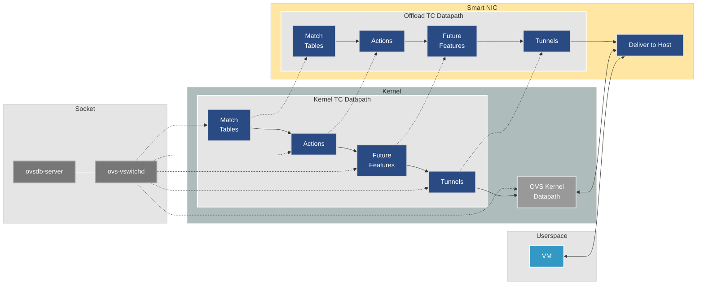

# OVS: 

## Introduction:

OVS is a multi-layer SW switch, Its designed to operate a virtual switch within Hypervisor and Container
environments such as KVM, Xen, Proxmox, to handle traffic between VM's and external physical networks. 

Since Hypervisor ( KVM ) and containers ( docker ) are built on top of standard Linux networking, "OVS" runs
as native system daemon directly on the host OS. 

You can use Open vSwitch on standard Linux bare-metal server or desktop to replace or augment the
traditional Linux bridge ( `bridge-utils` / `ip link add br0 type bridge` ).


### Where Open-vSwitch can run:

- **Standard Linux Bare-metal**: 

    Runs as regular system service ( `ovs-vswitchd` and `ovsdb-server` ) on distributions like
    Ubuntu, Debian, RHEL, CentOs ..

- **Other OS's**: 

    `OVS` is ported to FreeBSD, and Microsoft ( Hyper-V )

- **SmartNICs / HW Switches**: 

    OVS runs on HW acceleration platforms and smart NICs using DPDK ( Data Plane Development kit ) or
    HW offloading.


### OVS over Linux Bridge:

Default Linux Switch is simple and light-weight and works excellently for simple setups, but lacks other
features like programmatic control, advance tunneling, enhanced monitoring. 

- **programmatic Control**: If you want to use a SDN controller to inject OpenFlow rules directly into
  host networking. 

- **Advanced tunneling**: If the host needs to act as gateway terminating `VXLAN` or `GRE` tunnels from 
other parts of the data center. 

- **Enhanced Monitoring**: If you require fine-grain traffic analytics via `sFlow` or `Netflow` directly from
  the host interface.


### Key Features: 

- `L2/L3 Switching`: Supports std bridging, MAC address learning, 802.1Q VLAN tagging, and trunking

- `Tunneling Protocols`: Built-in support for overlay networks using VXLAN, GRE, Geneve, and ERSPAN to
  connect VMs across different physical hosts.

- `OpenFlow Support`: Exposes programmatic control interfaces, allowing an SDN controller to dynamically
  manage and modify packet-forwarding rules

`Note`: 
--- 
- OpenFlow: 
    It's a vendor-neutral, southbound communication standard in SDN that separates the control plane
    from the data plane. It lets a centralized controller program the forwarding and flow tables of
    physical or virtual switches.
--- 

- **Network Visibility & QoS**: Integrates monitoring tools like NetFlow, sFlow, and RSPAN, alongside
  per-interface traffic policing and Quality of Service (QoS) controls


## Core Architecture:

**OVS** separates its components across the kernel and user space for performance and flexibility:

- `ovs-vswitchd`: The core user-space daemon that implements the switch logic and communicates with
  OpenFlow controllers.
- `ovsdb-server`: A lightweight JSON database daemon that stores configuration data persistently across
  system reboots.
- `Kernel Module`: Caches packet matches and actions for high-speed “fast path” forwarding, punting
  unmatched “slow path” packets up to user space (ovs-vswitchd).

### Basic management commands:

OVS bridges and ports can be managed using tools like `ovs-vsctl`:

- Create a bridge:

    `ovs-vsctl add-br br0`

- Add a port to a bridge: 
    
    `ovs-vsctl add-port br0 eth0`

## OVS overview:

OVS vSwitch consists of 3 main components that work together to move packets:


1. **Ports ( the doors )**: 
    - These are connection points where packets enter/leave. They can be physical cards on your
      server, or virtual ports connected to individual VMs or containers. 

2. **The Kernel Datapath ( The Fast Gate/ Worker )**: 
    - This lives inside the kernel and handles heavy lifting. Its job is to move packets as fast as
      possible using quick-reference list ( the `Megaflow cache` ). Most packets never leave this layer. 

3. **The user-space daemon / `ovs-vswitched` ( The brain/ Main office):
    - This runs in userspace (outside the kernel). It holds the big, complex rulebook called OpenFlow
      tables. The datapath only talks to this department when it doesn’t know what to do with a new
      kind of packet.

### **The Full Journey of a Packet**

When a packet flows through OVS from input to output, it takes this exact path:

1. **Arrival:** A packet arrives at an **Input Port** (e.g., from a VM or physical cable).
2. **The Fast Check:** The **Kernel Datapath** immediately checks its quick-reference list.
* **If it knows the rule:** It instantly applies the action (like modifying headers or forwarding) and
  shoots the packet out the **Output Port**. *Journey ends here for 99% of normal traffic.*


3. **The Unknown Packet (The Upcall):**
* **If it doesn't know the rule:** The datapath pauses, packages up the packet header, and sends an
  "upcall" message up to the **Userspace Daemon (`ovs-vswitchd`)**.


4. **The Brain Decides:**
* The userspace daemon looks at the packet, runs it through its complex **OpenFlow tables**, and figures
  out the master policy for where this packet should go.


5. **Learning for Next Time:**
* The daemon tells the kernel datapath: *"Send this packet to Port B, and remember this rule for next time
  so you don't have to call me again."*


6. **Departure:** The packet is sent out through the designated **Output Port**.

    | OVS Architecture |
    | :---: |
    |  |


---

## Core components of Open vSwitch (OVS):


### **1. Ports and Interfaces (The Entry and Exit Points)**

* **What they are:** These are the physical or virtual connection points where packets enter and leave the
  switch.
* **Types:**
* **Physical Ports:** Real network interface cards (NICs) on the host machine (e.g., `eth0`).
* **Virtual Ports (VIFs / TAP devices):** Interfaces connected to virtual machines, containers, or
  namespaces.
* **Tunnel Ports:** Virtual ports used to encapsulate traffic (like VXLAN or GRE) to send packets across
  physical networks to other servers.

---

### **2. `ovsdb-server` (The Configuration Database)**

* **What it is:** The persistent storage system for OVS. It holds all the configuration data—such as what
  bridges exist, which ports belong to which bridge, and what controllers are connected.
* **How it works:** When you run commands like `ovs-vsctl add-br br0`, you are talking directly to
  `ovsdb-server`. The OVS daemon (`ovs-vswitchd`) reads this database to know how the switch is supposed
  to be structured.

---

### **3. `ovs-vswitchd` (The Userspace Daemon / The Brain)**

* **What it is:** The main software daemon that runs in userspace (standard operating system space,
  outside the Linux kernel).
* **How it works:** It acts as the manager and bridge controller. It implements the standard **OpenFlow
  protocol**, talks to external SDN controllers if configured, and computes packet paths when the kernel
  doesn't know what to do with a packet.

---

### **4. OpenFlow Flow Tables (The Master Rulebook)**

* **What they are:** A set of structured, prioritized tables managed inside the `ovs-vswitchd` daemon.
* **How they works:** Unlike simple switches, OpenFlow allows deep, programmable control. A table contains
  rules that say: *"If a packet matches criteria X, perform actions Y (like rewrite headers, send to port
  Z, or pass to table 2)."* This is where complex networking policies live.

---

### **5. The Kernel Datapath (`ovs_kernel` module or Userspace `netdev` / DPDK)**

* **What it is:** The high-performance packet-processing engine. In standard Linux deployments, it runs
  directly inside the **Linux kernel** to process packets as fast as possible without context-switching to
  userspace. (If using DPDK, it runs in userspace but bypasses the OS kernel for extreme speed).
* **How it works:** It acts as the fast-path forwarding engine. It checks incoming packets against active
  rules and forwards them instantly.

---

### **6. The Megaflow Cache (The Fast-Reference List)**

* **What it is:** A temporary, wildcarded cache maintained inside the kernel Datapath.
* **How it works:** Instead of sending every single packet up to the heavy OpenFlow pipeline
  (`ovs-vswitchd`), the datapath checks this cache. If a packet matches an active entry, it is forwarded
  instantly in microseconds.

---

### **The Complete Component Checklist**

#### **1. Ports and Interfaces (The Entry/Exit Gates)**

* **Physical NICs, TAP devices, veth pairs, or VIFs:** Where packets physically or virtually enter and
  leave the switch.

#### **2. Alternative Datapaths (How Packets Are Handled at the Lowest Level)**

* **The Kernel Datapath (`ovs_kernel`):** The default module running inside the Linux kernel, using
  standard kernel packet buffers.
* **DPDK (Data Plane Development Kit):** A userspace datapath framework that bypasses the OS kernel
  entirely, polling NICs directly via PMD (Poll Mode Driver) threads for extreme raw performance.
* **AF_XDP (Address Family eXpress Data Path) — *(The High-Performance Linux Alternative)*:**
* *What it is:* A modern Linux socket-based mechanism built on eBPF (Extended Berkeley Packet Filter).
* *Where it fits:* It acts as a specialized netdev datapath type (`type=afxdp`) that hooks directly into
  an XDP program on the network card driver.
* *Why it’s used:* It provides ultra-fast packet movement between the driver/kernel and userspace with
  zero-copy options, matching much of DPDK's high throughput while still allowing you to use standard
  Linux networking tools (like `ip` commands).

#### **3. The Megaflow Cache (The Fast-Reference List)**

* A wildcarded cache kept right at the datapath layer. If a packet matches an entry here, it is forwarded
  instantly without waking up the main userspace brain.

#### **4. `ovsdb-server` (The Configuration Database)**

* The persistent backend database holding the structural blueprint of your switch (bridges, ports,
  configurations, controller IPs).

#### **5. `ovs-vswitchd` (The Userspace Daemon / The Brain)**

* The core management daemon running in userspace. It processes "flow misses" sent up from the datapath
  and drives the control plane.

#### **6. OpenFlow Flow Tables (The Master Rulebook)**

* Structured, prioritized rule sets housed inside `ovs-vswitchd` that handle complex matching criteria,
  tunneling, and forwarding policies.

---

### **The Full End-to-End Packet Journey**

When you combine every piece into a single timeline, a packet moves through the system like this:

1. **Arrival at the Port:** A packet hits a physical card, a virtual container interface, or an **AF_XDP /
   DPDK** accelerated queue.
2. **The Fast Check:** The low-level datapath checks its active **Megaflow Cache**.
* *If found:* The action executes instantly, and the packet leaves through the output port. (Fast path
  complete).
* *If missing:* A **Flow Miss Upcall** is triggered.


3. **The Upcall to Userspace:** The packet header is sent up to the **`ovs-vswitchd`** daemon.
4. **OpenFlow Pipeline Evaluation:** The daemon evaluates the packet against the master **OpenFlow Flow
Tables** to determine the exact policy.
5. **Caching for the Future:** `ovs-vswitchd` translates that policy into a generalized wildcard rule and
pushes it down into the **Megaflow Cache**.
6. **Departure:** The packet is sent out through the designated **Output Port**.


### Recap:

- `ovs-vsctl`: configures what you want.
- `ovsdb-server`: Stores the configuration.
- `ovs-vswitchd`: Programs the switching behaviour.
- **Kernel Datapath**: Forwards packets ( implemented by the kernel module )

**Inspect Configuration**

- `ovs-vsctl show`
- `ovs-vsctl list-br`
- `ovs-vsctl list-ports br0`
- `ovs-vsctl list-ports br1`

Inspect individual interfaces:

- `ovs-vsctl list interface`

Inspect forwarding database:

- `ovs-appctl fdb/show br0` ( this is  similar to `bridge fdb show` )

Show Interface stats:

- `ovs-ofctl dump-ports br0`

Create bridge, add interface, remove interface , delete bridge , list bridges and ports:

- `ovs-vsctl add-br br0`
- `ovs-vsctl add-port br0 eth0`
- `ovs-vsctl del-port br0 eth0`
- `ovs-vsctl deb-br br0`
- `ovs-vsctl list-br`
- `ovs-vsctl list-ports br0`


#### OVS-ports : access vs trunk

Suppose you have
```text 
      	     br0
       ┌──────────────┐
       │              │
     eth0           tap0
       │              │
       └──────────────┘
```

By default, an OVS port is a trunk port.

That means it can carry traffic from multiple VLANs.

**Access port**

For example, put `tap0` in `VLAN 100`:

`ovs-vsctl add-port br0 tap0 tag=100`

Frames entering `tap0` are associated with `VLAN 100`.

**Trunk port**
Allow VLANs 100, 200 and 300:

`ovs-vsctl set port eth0 trunks=100,200,300`

**Inspect VLAN configuration**

`ovs-vsctl list port`

#### OVS internal interfaces

This is another important concept, especially if you want to assign an IP address to an OVS bridge.

With Linux bridges, you commonly assign an IP to br0.

OVS also supports this:

`ovs-vsctl add-br br0`

This automatically creates an internal interface named br0.

You can configure it:

```bash
ip addr add 192.168.10.1/24 dev br0
ip link set br0 up
```
The distinction:

- Physical port: forwards packets through a physical NIC.

- Internal port: represents the bridge inside the Linux network stack.

This is useful for host management, routing and network namespaces.

#### OVS patch ports

Patch ports are effectively virtual Ethernet cables between two OVS bridges.

For example:

```text
       br0                  br1
   ┌──────────┐         ┌──────────┐
   │          │         │          │
   │ eth0     │         │ eth1     │
   │          │         │          │
   │ patch0 ──┼─────────┼── patch1 │
   │          │         │          │
   └──────────┘         └──────────┘

```
Configuration:

```bash
ovs-vsctl \
  -- add-port br0 patch0 \
  -- set interface patch0 type=patch options:peer=patch1 \
  -- add-port br1 patch1 \
  -- set interface patch1 type=patch options:peer=patch0
```

This is entirely internal to OVS.

#### OpenFlow: where OVS becomes powerful:

The above discussion is OVS as normal switch.

But OVS can also operate using explicit OpenFlow rules.

For example, inspect the current flow table:
`ovs-ofctl dump-flows br0`

A normal standalone bridge generally has a default flow that invokes normal switching behavior.

You can inspect its ports:  
`ovs-ofctl show br0`

OpenFlow allows you to express rules such as:
    - Forward packets from port 1 to port 2.
    - Drop packets from a particular MAC address.
    - Forward packets based on VLAN ID.
    - Redirect traffic to another port.
    - Mirror traffic.
    - Apply packet modifications.

The Linux kernel OVS datapath handles forwarding, while OpenFlow provides a programmable way to control
forwarding decisions

---

# Network Flows and OVS :

A **Flow** is a sequence of related network packets that share common characteristics ( like Source and
destination IP address, ports or protocol types )

> Instead of looking at every single TCP packet as a brand new event an entire web browsing session or a
> video stream can be identified as s single flow. 

**Flow Table**: It's a data structure inside a programmable network switch ( commonly used in SDN ) that
stores a set of flow entries to decide how to process and forward those packets. 

Flow table replace or extend traditional static switching/routing tables with programmable database rules.
When a packet arrives at a switch the switch inspects the packet against the flow table. 

Each Flow entries inside a flow table typically contains:

- **Match Field**: Criteria to identify specific packets (ex: Specified destination IP and TCP port )

- **Priority**: Determines the order of evaluation if a packet matches multiple rules. 

- **Counters**: Track statistics like the total number of matching packets and bytes. 

- **Instructions/Actions**: What to do with the matching packet ( ex: forward out a specific port drop the
  packet, modify VLAN/IP headers or send the packet to an SDN Controller. )

- **Timeout**: Idle of hard timers that remove old or unused flow entries automatically. 

*How does all of this work*:

- **Packets arrival**: A packet enters a _openFlow_ enabled switch. 

- **Table Lookup**: Switch compares the packet against the _flow table_.

- **Action Execution** If a match is found, the switch performs the defined action ( such as forwarding or
  altering the packet ), for more advanced switched, packets can pass through a pipeline of multiple
  sequential flow tables using `Goto-Table` instructions.

- **Table-Miss**: If no rule matches the packet, a fallback rule ( the Table-Miss entry ) dictates whether
  to drop the packet, flood it, or forward it up to a centralized software controller for instructions. 

## How OVS implements flows:

**OVS** operates both spaces:
    - user-space: complex decisions and SDN protocol handling happen
    - kernel space: Packet are forwarded at blazing fast speeds. 
    
To achieve high performance, **OVS** splits its flow processing into two distinct parts: 

1. **OpenFlow tables ( user-space: handled by `ovs-vswitchd` )**:

- This is where your actual SDN controller ( like ONOS, OpenDaylight ) or manual configuration scripts
  inject routing logic. 

- It supports multiple pipeline tables, wildcard matching, priorities, and intricate routing logic. 

- Because matching packets against deep complex rules takes time, running every single packet through these
  user-space tables would severely bottleneck network performance.

2. **The Datapath ( kernel space / openvswitch.ko )**:

- To solve the spreed issue, OVS utilizes a kernel-space cache called the **DataPath**.

- When a packet first arrives, if the kernel does not recognize it, it sends it up to the user space
  ("upcall").

- The user-space daemon checks its multi-table OpenFlow rules, decided what to do and then installs a
  incredibly simple, exact-match rule directly into the kernel datapath. 

- Subsequent packets in that exact same stream match the kernel cache immediately and never leave the kernep
  space, resulting in near-line-rate forwarding speeds. 

### The Evolution of OVS Flow Tables

As networks grew larger, exact-match caching wasn't enough because any slight variation in a packet (like a
changing port number) triggered a slow user-space upcall. OVS engineered two primary technologies to make
flow tables even smarter:

| Flow Technology | How it Works | Primary Benefit |
| :--- | :--- | :--- |
| Microflow Caching	| Matches packets on an exact 1:1 basis across all header fields. | Super fast, but handles wildcards poorly; easily flooded by new connections. |
| Megaflow Caching | Group-based classifier that allows wildcarding in the kernel datapath (e.g., matching a whole subnet instead of one IP). | Drastically reduces upcalls to user space for varied traffic.|


### More on Flow: 

Traditional switches look at the destination MAC address and decides which port should receive the packet. 

OVS inspects multiple packet fields and make forwarding decisions based on them. 

Ex:
```text 
Match:
    Source MAC       = AA:BB:CC:DD:EE:FF
    Destination MAC  = 11:22:33:44:55:66
    VLAN ID          = 100
    Source IP        = 192.168.1.10
    Destination IP   = 192.168.2.20
    Protocol         = TCP
    Destination Port = 443

Action:
    Output to port 5
```

This combination of:

- Match criteria
- Actions

is called a **Flow**.

In OVS, flows are stored in flow tables and evaluated against incoming packets.


### Packet processing Architecture:

Let's look at the general architecture.

Discover Open vSwitch (OVS): What Is It and How Does It Work?

[open vSwitch Arch](https://cloudification.io/cloud-blog/open-vswitch-ovs-what-is-it-and-how-does-open-virtual-switch-work)


**OVS** has two important components:

1. **Control plane**: `ovs-vswitchd` (userspace daemon).
2. **Data plane**: Kernel datapath or a userspace datapath such as DPDK.

Consider what happens when a packet arrives.

**Packet processing in OVS**

```text 
           Incoming Packet ( physical NIC / Virtual NIC )
                 |
                 v
        +-------------------+
        | Datapath Flow     |( Is there an existing matching flow? )
        | Lookup            | 
        +-------------------+
                 |
         +-------+-------+
         |               |
        HIT             MISS
         |               |
         v               v
  +-------------+  +---------------------------+
  | Execute     |  | Upcall to                 |
  | Flow Actions|  | ovs-vswitchd              |
  | (fast path )|  |ovs-vswitchd processes pkt |
  +-------------+  +---------------------------+
         |               |
         |               v
         |        +-----------------+
         |        | Flow Processing | ( Subsequent matching packets can use the fast path )
         |        | and Installation|
         |        +-----------------+
         |               |
         +-------+-------+
                 |
                 v
          Packet Forwarding
```

This brings us to the different types of flows.

### SW Flows (Software Flows)

These flows are processed by software rather than directly by NIC hardware.

For example, with the Linux kernel datapath:

- Packet arrives at the NIC.
- Linux receives the packet.
- OVS kernel datapath looks up a matching flow.
- If a matching flow exists, its actions are executed.
- The packet is forwarded without requiring userspace processing for every packet.

The important distinction:

**A software flow does not necessarily mean that every packet is processed by the OVS userspace daemon.**

The Linux kernel can process packets very efficiently using its datapath flow cache.

You can inspect software datapath flows using:

```bash
sudo ovs-appctl dpctl/dump-flows
```

Example output:

```text
recirc_id(0),in_port(1),eth_type(0x0800),
ipv4(src=192.168.1.10,dst=192.168.2.20),
tcp(dst=443), packets:100, bytes:12000,
used:0.5s, actions:output(2)
```

This is a software datapath flow.

###  HW Flows (Hardware Offloaded Flows)

Modern NICs have hardware packet-processing capabilities.

Instead of asking the CPU to process every packet, OVS can offload flow rules into the NIC.

For example:

```text
Match:
    Source IP      = 192.168.1.10
    Destination IP = 192.168.2.20
    Protocol       = TCP
    Destination Port = 443

Action:
    Forward to physical port
```

or 
```text 
    +----------------------------------------------|+
    | Example: Three TCP connections                |
    |                                               |
    | Connection A:                        Flow A   |
    | 192.168.1.10:50000 → 10.0.0.20:443            |
    +---------------------------------------------- +
    | Connection B                         Flow B   |
    | 192.168.1.11:50001 → 10.0.0.20:443            |
    +---------------------------------------------- +
    | Connection C                         Flow C   |
    | 192.168.1.10:50002 → 10.0.0.30:80             |
    +---------------------------------------------- |+
```

Although all three connections use TCP, they have different identifying fields.

A flow is typically identified by a combination of packet-header fields, commonly called a 5-tuple:

| Field | Example |
| --- | --- |
| Source IP | 192.168.1.10 |
| Destination IP | 10.0.0.20 |
| Source port | 50000 |
| Destination port | 443 |
| Protocol | TCP |

This combination identifies Flow A.

However, a flow does not always have to use all five fields. Depending on the flow definition, it might match only:

- Source and destination MAC addresses.
- Source and destination IP addresses.
- VLAN ID.
- IP protocol.
- TCP/UDP ports.
- Tunnel ID or other metadata.

OVS communicates this rule to the NIC driver, which programs the NIC's hardware flow tables.

Now the NIC itself can:

1. Receive the packet.
2. Match its headers against the hardware flow rule.
3. Execute the configured forwarding action.
4. Forward the packet without normal host CPU packet processing.

Link-Inline™ Software - Napatech

[stateful flow mgmt and offloading napatech.com](https://www.napatech.com/products/link-inline-software)


This is called Hardware Flow Offloading.

Some examples of hardware technologies involved:

- Intel Ethernet Flow Director
- Intel ADQ (Application Device Queues)
- Mellanox/NVIDIA ConnectX hardware steering
- TC flower hardware offload
- NIC embedded switching (eSwitch)

Not every NIC supports all flow matching and action combinations.

```bash 
# Look for `harware-tc-offload` to check if the driver supports HW flow offloading.
# ethtool -k <interface_name> | grep "hw-tc-offload"

ethtool -k enp1s0f0 |grep "hw-tc"
hw-tc-offload: on

# or for connectx NICs ( make sure the driver exposes representor device and supports `switchdev` mode
# rather than `legacy` mode)
# `devlink dev eswitch show pci/<bus_address>`

# or check OVS kernel and Flow offload status ( return true )
sudo ovs-vsctl get Open_vSwitch . other_config:hw-offload
```

## 5. SW Flow vs HW Flow

| Feature | SW Flow | HW Flow |
| --- | --- | --- |
| Processing | CPU / software datapath | NIC hardware |
| Flow storage | Kernel or userspace datapath | NIC hardware tables |
| CPU utilization | Uses host CPU | Reduces host CPU usage |
| Throughput | Depends on CPU and datapath | Can achieve high throughput |
| Latency | Depends on software path | Can reduce processing latency |
| Limitations | Software-supported actions | Hardware-supported match/actions |
| Capacity | System memory / datapath limits | NIC hardware flow-table limits |

One important detail: hardware offloading is not simply a matter of copying every OVS flow into the NIC. 
The NIC must support the required match fields and actions.

### How to inspect SW and HW flows in Linux

This is where the practical OVS commands become useful.

A. Check the OVS datapath type

```bash
ovs-vsctl get Bridge br0 datapath_type
```

Typical results:

- Empty string: Linux kernel datapath.
- `netdev`: Userspace datapath (often DPDK).

B. Dump datapath flows

```bash
sudo ovs-appctl dpctl/dump-flows
```

C. Check hardware offloading configuration

```bash
ovs-vsctl get Open_vSwitch . other_config
```

Look for:

```text
hw-offload=true
```

You can also check:

```bash
ovs-vsctl get Open_vSwitch . other_config:hw-offload
```

D. Inspect TC hardware-offloaded rules

```bash
sudo tc -s filter show dev eth0 ingress
```

Look for:


```text
in_hw
```

This indicates that a rule has been installed in hardware.

You may also see:


```text 
not_in_hw
```

This means the rule is not currently offloaded.

### One more important distinction: OpenFlow vs Datapath Flows

These two terms are often confused.

OVS actually has two different flow concepts:

| OpenFlow flows | Datapath flows |
| --- | --- |
| Managed by OVS control plane | Used by packet-processing datapath |
| Configured using `ovs-ofctl` | Inspected using `ovs-appctl dpctl` |
| Logical switching rules | Optimized packet-processing rules |
| Can contain multiple tables and complex logic | Usually represent specific packet-processing paths |

For example:

An OpenFlow rule might say:

```bash
ovs-ofctl add-flow br0 \
"priority=100,in_port=1,ip,actions=output:2"
```

OVS translates the logical processing decision into datapath operations.

The datapath may then install a more specific flow to accelerate subsequent packets.

ex: 
```bash 
ovs-ofctl add-flow br0 \
"priority=100,ip,tcp,tp_dst=443,actions=output:2"
```
- Tells OVS to forward matching TCP packets destined for port 443 to OpenFlow port 2. 
- when packet arrives `ovs-vswitchd` processes the OpenFlow pipeline and can install corresponding datapath
  flows. 
- The datapath flow allows subsequent matching packets to be processes efficiently without repeatedly
  traversing the entire user-space OpenFlow pipeline. 

### The bigger picture

There are actually three levels worth understanding:

```text 

    +--------------------------------------------------------------+
    | Level 1                                                      |
    | **OpenFlow**                                                 |
    | Logical forwarding policy. What should happen to packets?    |
    +--------------------------------------------------------------+
    | Level 2                                                      |
    | **Software Datapath Flows**                                  |
    | Kernel or userspace implementation of forwarding decisions.  |
    +--------------------------------------------------------------+
    | Level 3                                                      |
    | Hardware Offloaded Flows                                     |
    | NIC implements supported forwarding decisions directly in hw.|
    +--------------------------------------------------------------+

```

### Flow MISS in detail.

Consider a new TCP connection:

`192.168.1.10:50000 → 10.0.0.20:443`

Initially, the datapath might not have a matching flow.

The processing sequence is:

1. The packet arrives at the datapath.
2. The datapath cannot find a matching flow.
3. An upcall sends packet information to ovs-vswitchd.
4. ovs-vswitchd processes the packet through the OpenFlow pipeline.
5. OVS determines the appropriate forwarding actions.
6. A datapath flow can be installed.
7. Subsequent matching packets can use the fast path.

One important nuance: a miss does not necessarily mean that OVS installs a flow immediately. The result
depends on packet processing, flow configuration, and datapath behavior.

### HW offloading 

Let's look at the difference between software and hardware forwarding.



Without hardware offloading:

```text 
        NIC
         |
         v
      Host CPU
         |
         v
     OVS datapath
         |
         v
    Forward packet
```

With hardware offloading:

```text 
            NIC
             |
             v
    NIC hardware flow table
             |
             v
         Match flow
             |
             v
    Execute forwarding action
             |
             v
        Physical port
```

The key difference is where the packet-processing work happens.

However, hardware offloading does not mean that the CPU is completely eliminated. The CPU and ovs-vswitchd
still participate in control-plane operations, flow management, exceptions, and other tasks.


## How HW Support Flow offloading: 

Hardware Flow offloading requires support from both the NIC hardware and its driver. 

But there is another important component in between: the Linux kernel's networking infrastructure and the
OVS hardware-offload integration.

**OVS does not typically communicate directly with the NIC and write hardware flow-table entries itself**.
Instead, it uses a software interface to request that the driver program the NIC.

## HW flow offloading actual mechanism.

### 1. The components involved

Consider a system with:

- Open vSwitch (`ovs-vswitchd`)
- Linux kernel
- NIC driver
- NIC hardware (SmartNIC or an offload-capable NIC)

The architecture looks approximately like this:

```text 
    +------------------+
    | OVS userspace    | OpenFlow pipeline and flow management
    | `ovs-vswitchd`   |
    +------------------+
        |
        v 
    +------------------------------------+
    | Linux kernel                       | Hardware-offload request and flow management
    | TC flower/switchdev infrastructure |
    +------------------------------------+
        |
        v 
    +-------------+
    | NIC driver  | Translates flow rules into hardware-specific commands
    +-------------+
        |
        v 
    +---------------------------------------------------+
    | NIC HW                                            | Matches packets and executes actions
    | Hardware flow tables / packet-processing pipeline |
    +---------------------------------------------------+
```

There are different offload implementations, but this is a useful model for understanding the common Linux
kernel datapath TC-offload path.

### 2. How does OVS actually program the NIC?

There are two common mechanisms worth understanding:

1. **TC flower offload**: OVS uses the Linux kernel's Traffic Control (TC) infrastructure.
2. **DPDK rte_flow offload**: OVS uses DPDK's flow API to request hardware flow programming.

Let's first understand TC flower, because it is a common implementation in Linux kernel-based OVS deployments.

### Approach A: TC flower hardware offload

The architecture is:

```text
          ovs-vswitchd
               |
               | Flow installation request
               v
       OVS TC offload interface
               |
               v
        Linux TC subsystem
               |
               | Netlink messages
               v
         NIC kernel driver
               |
               | Hardware-specific commands
               v
          NIC firmware
               |
               v
       Hardware flow tables
```

Let's understand each step.

#### Step 1: OVS decides to offload a flow

Suppose OVS has this forwarding rule:

```text
Match:
    Source IP      = 192.168.1.10
    Destination IP = 192.168.2.20
    Protocol       = TCP
    Destination Port = 443

Action:
    Output to port 5
```

After processing a packet and determining the forwarding behavior, OVS attempts to install an equivalent
datapath flow in hardware.

It translates the flow into a representation understood by the Linux TC flower interface.

#### Step 2: OVS uses TC flower

TC flower is a Linux traffic-control classifier that supports matching packet fields and executing actions.

For example, a simplified equivalent TC rule might look like:

```bash
tc filter add dev eth0 ingress protocol ip \
    flower \
    src_ip 192.168.1.10 \
    dst_ip 192.168.2.20 \
    ip_proto tcp \
    dst_port 443 \
    skip_sw \
    action mirred egress redirect dev eth1
```

Here:

- `flower` defines the packet matching criteria.
- `src_ip` and `dst_ip` specify IP matching.
- `ip_proto` specifies TCP.
- `dst_port` specifies the destination port.
- `mirred` specifies a redirect action.
- `skip_sw` requests hardware-only processing rather than a software fallback.

This is an illustrative equivalent rule, not necessarily the exact rule OVS generates.

The important point is that OVS communicates the flow to Linux TC using the kernel's networking interfaces.

#### Step 3: Linux communicates with the NIC driver

This is where things get interesting.

The TC subsystem receives the flow configuration through Netlink.

It then invokes the driver's hardware-offload implementation.

For network drivers, an important kernel interface is:

```c
ndo_setup_tc()
```

This is a callback exposed through the network device's `net_device_ops`.

Conceptually:

```c
static const struct net_device_ops my_netdev_ops = {
    .ndo_setup_tc = my_driver_setup_tc,
};
```

The driver implements this callback to handle TC configuration requests.

The driver can then:

- Validate the requested match fields.
- Check whether the requested actions are supported.
- Allocate hardware flow-table resources.
- Translate the rule into NIC-specific commands.
- Program the hardware.

Not every driver implements every TC feature. The supported capabilities depend on the driver and NIC.

#### Step 4: The driver programs NIC hardware

Now the NIC driver communicates with the NIC's hardware/firmware interface.

For example, consider an NVIDIA ConnectX NIC using the `mlx5` driver.

The driver has hardware-specific flow-management infrastructure. It translates the requested TC rule into the NIC's internal flow steering representation.

The NIC may have structures such as:

- Flow tables.
- Flow groups.
- Flow entries.
- Match criteria.
- Forwarding destinations.
- Modify-header actions.

The hardware can then execute these rules directly.

The exact implementation is vendor-specific.

This is the key point: OVS does not need to understand the internal hardware flow-table format of every NIC. The driver handles that translation.

References: [OVS TC flower offload documentation](https://docs.openvswitch.org/en/latest/howto/tc-offload/) · [Red Hat TC flower offload architecture](https://docs.redhat.com/en/documentation/red_hat_openstack_platform/17.1/html/configuring_network_functions_virtualization/config-ovs-hwol_rhosp-nfv).

#### 3. What exactly does the NIC driver do?

Let's take `mlx5_core` as an example.

Suppose the kernel receives this request:

```text
Match:
    Source IP      = 192.168.1.10
    Destination IP = 192.168.2.20
    TCP destination port = 443

Action:
    Redirect to destination port
```

The driver needs to translate this generic request into something the NIC understands.

Conceptually, the process is:

```text
    TC flower rule
          |
          v
    mlx5 driver receives request
          |
          v
    Validate match fields
          |
          v
    Validate actions
          |
          v
    Allocate hardware flow entry
          |
          v
    Create NIC flow-steering rule
          |
          v
    NIC firmware / hardware
          |
          v
    Rule installed
```

For example, the hardware might represent the rule conceptually as:

```text
+---------------------------------------+
| NIC Hardware Flow Table               |
+---------------------------------------+
|                                       |
| Entry 1                               |
|                                       |
| Match:                                |
|   IPv4 source      = 192.168.1.10     |
|   IPv4 destination = 192.168.2.20     |
|   IP protocol      = TCP              |
|   TCP destination  = 443              |
|                                       |
| Action:                               |
|   Forward to eSwitch port 5           |
|                                       |
+---------------------------------------+
```

This is conceptual, not the actual binary hardware representation.

The NIC's firmware and hardware implement the vendor-specific flow-steering pipeline.

For NVIDIA ConnectX devices, this is commonly associated with the NIC's embedded switch (eSwitch) and hardware steering infrastructure.

#### 4. Approach B: DPDK rte\_flow offloading

There is another important path, particularly when OVS uses DPDK.

Instead of going through Linux TC flower, OVS can use the DPDK `rte_flow` API.

The architecture becomes:

```text
             ovs-vswitchd
                  |
                  v
            OVS DPDK datapath
                  |
                  v
           DPDK rte_flow API
                  |
                  v
             DPDK PMD
         (Poll Mode Driver)
                  |
                  v
          NIC-specific driver
                  |
                  v
           NIC firmware
                  |
                  v
         Hardware flow tables
```

Here is an illustrative DPDK flow-programming example:

```c
struct rte_flow_attr attr = {
    .ingress = 1,
};

struct rte_flow_item pattern[] = {
    // Ethernet
    // IPv4
    // TCP
    // End
};

struct rte_flow_action actions[] = {
    // Redirect to destination port
    // End
};

struct rte_flow_error error;

struct rte_flow *flow;

flow = rte_flow_create(
    port_id,
    &attr,
    pattern,
    actions,
    &error
);
```

The important function is:

```c
rte_flow_create()
```

It asks the PMD to create a flow rule.

The PMD translates the generic DPDK flow description into hardware-specific operations.

If the NIC supports the requested pattern and actions, it programs the hardware.

Notice the difference:

| TC flower | DPDK rte\_flow |
| --- | --- |
| Uses Linux TC infrastructure | Uses DPDK flow API |
| Uses Netlink to configure TC | Uses DPDK PMD APIs |
| Driver implements kernel offload support | PMD implements DPDK flow support |
| Common in kernel datapath OVS | Common in OVS-DPDK |

DPDK hardware offloading also depends on the PMD supporting the requested flow patterns and actions.

#### 5. Does every flow get offloaded?

No. This is a very important detail.

Suppose you request:

```text
Match:
    Source IP = 192.168.1.10
    Destination IP = 192.168.2.20

Actions:
    NAT
    Connection tracking
    Output to port 5
```

Your NIC might support:

- IPv4 matching.
- TCP matching.
- VLAN operations.
- Packet redirection.
- Packet modification.

But it might not support the complete connection-tracking or NAT behavior requested.

In that situation, OVS cannot necessarily offload the entire flow.

Depending on the datapath and supported features, it might:

- Offload the supported portion.
- Keep the flow in software.
- Reject the offload request.
- Use a combination of hardware and software processing.

This is why hardware-offload capability is not simply a yes/no property.

It depends on the specific combination of:

1. NIC hardware.
2. NIC firmware.
3. Kernel driver.
4. Linux kernel support.
5. OVS version.
6. Requested match fields and actions.

#### 6. How do you enable and verify hardware offloading?

Let's use the TC flower implementation as an example.

##### Enable hardware offloading in OVS


```bash
sudo ovs-vsctl set Open_vSwitch . \
    other_config:hw-offload=true
```

OVS also supports configuring its TC offload policy:

```bash
sudo ovs-vsctl set Open_vSwitch . \
    other_config:tc-policy=none
```

The policies are:

| Policy | Behavior |
| --- | --- |
| `none` | Install rules in both software and hardware where supported |
| `skip_sw` | Require hardware offloading |
| `skip_hw` | Use software only |

The exact behavior is documented in the NVIDIA driver documentation.

##### Enable TC hardware offload on the NIC

Check whether the driver exposes the capability:

bash

```bash
ethtool -k eth0 | grep hw-tc-offload
```

Enable it if supported:

bash

```bash
sudo ethtool -K eth0 hw-tc-offload on
```

##### Inspect installed TC rules

bash

```bash
sudo tc -s -d filter show dev eth0 ingress
```

This displays TC flower rules and their statistics.

##### Inspect OVS datapath flows

bash

```bash
sudo ovs-appctl dpctl/dump-flows
```

You can also inspect the OVS logs for hardware-offload failures and unsupported actions.

#### 7. Putting everything together

Here is the complete picture.

Understanding OpenVswitch Hardware Offloading | kp0zhiqian's

|  | [kp0zhiqian.github.io](https://kp0zhiqian.github.io/posts/hardware_offload/) |
| :-- | :---: | 
|  |  |


```text
                OpenFlow Rule
                      |
                      v
                 ovs-vswitchd
                      |
                      v
                OVS Datapath
                      |
                      v
             Hardware Offload Request
                      |
              +-------+-------+
              |               |
              v               v
          TC Flower         DPDK
              |               |
              v               v
         Linux Kernel      rte_flow API
              |               |
              v               v
          TC Subsystem      DPDK PMD
              |               |
              v               v
          NIC Driver       NIC Driver
              |               |
              +-------+-------+
                      |
                      v
                 NIC Firmware
                      |
                      v
              Hardware Flow Table
                      |
                      v
              Hardware Forwarding
```

The two paths are alternatives, not necessarily sequential stages.

## 8. The most important takeaway

Think of the responsibilities this way:

| Component | Responsibility |
| --- | --- |
| OVS | Decides which flows and actions should be offloaded |
| TC / DPDK | Provides the interface for requesting flow programming |
| NIC driver / PMD | Translates generic flow requests into hardware-specific operations |
| NIC firmware | Manages hardware resources and flow-steering configuration |
| NIC hardware | Performs packet matching and forwarding |

OVS does not directly program the NIC registers or implement every vendor's hardware flow-table format. It requests offloading through a standard software interface, and the driver handles the hardware-specific implementation.

For further reading, these are particularly useful:

- [Open vSwitch – Flow Hardware Offload with Linux TC flower](https://docs.openvswitch.org/en/latest/howto/tc-offload/)
- [Open vSwitch – DPDK Hardware Offloading](https://github.com/openvswitch/ovs/blob/main/Documentation/howto/dpdk.rst)
- [NVIDIA – OVS-DPDK Hardware Acceleration](https://networking-docs.nvidia.com/doca/archive/3-2-0/ovs-dpdk-hardware-acceleration)

My recommendation for your next learning step: Study the NVIDIA `mlx5` driver and its TC flower implementation. It is an excellent real-world example of how a generic Linux TC flow eventually becomes a hardware flow-steering rule inside a NIC.


--------------------------------------------------------------

Todo: Order of reading

- Bridge and port management (ovs-vsctl).  [x]
- Internal interfaces and IP addressing.   [x] 
- Access ports, trunks and VLANs.          [x]
- Network namespaces and veth integration. [x]
- Patch ports and multiple bridges.        [x]
- OpenFlow rules (ovs-ofctl).          
- Datapath inspection and performance (ovs-appctl, ovs-dpctl).
- DPDK and hardware offloading.
